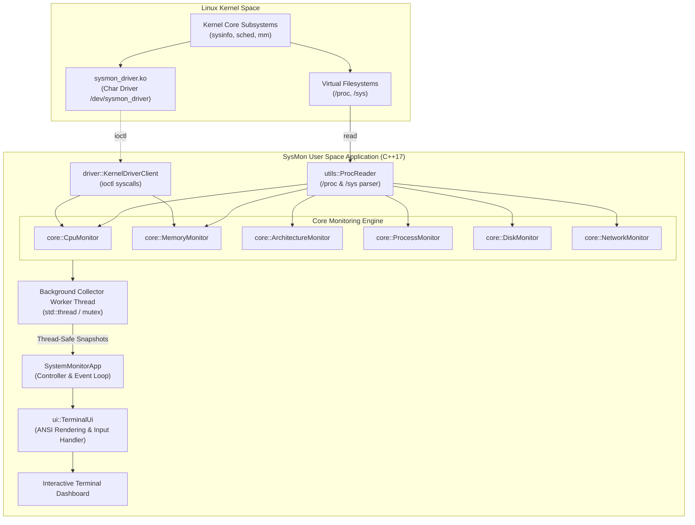

# SysMon: System Resource Monitoring Tool & Linux Kernel Driver

[](https://en.cppreference.com/w/cpp/17)
[](https://ubuntu.com/)
[](https://kernel.org)
[](https://cmake.org)
[-success.svg)]()

> **Individual Capstone Project**  
> **Course Track:** Linux, Device Drivers, System Programming & C++ (20-Day Comprehensive Training)  
> **Student Title:** System Resource Monitoring Tool using C++ on Ubuntu (WSL2)

---

## Table of Contents
1. [Project Overview](#project-overview)
2. [Alignment with 20-Day Training Concepts](#alignment-with-20-day-training-concepts)
3. [6-Stage Development Lifecycle](#6-stage-development-lifecycle)
4. [Key Features](#key-features)
5. [System Architecture](#system-architecture)
6. [Directory Structure](#directory-structure)
7. [Installation & Quickstart (Ubuntu / WSL2)](#installation--quickstart-ubuntu--wsl2)
8. [Linux Character Device Driver Guide](#linux-character-device-driver-guide)
9. [Running Tests & Benchmarks](#running-tests--benchmarks)
10. [Documentation Index](#documentation-index)

---

## Project Overview

**SysMon** is a system resource monitoring tool developed in C++ (C++17) for Ubuntu Linux and WSL2. It collects real-time system metrics using two complementary methods:
1. **Kernel Driver Interface:** A custom Linux character device driver (`/dev/sysmon_driver`) that fetches metrics directly from kernel memory via `ioctl()` calls.
2. **User-Space Virtual Filesystem Interface:** A multithreaded reader that parses the Linux `/proc` and `/sys` filesystems to gather process lists, CPU tick counts, hardware cache configurations, and I/O throughput.

The data is rendered in an interactive ANSI terminal interface with per-core CPU usage bars, RAM and swap gauges, hardware cache hierarchy info, disk and network transfer rates, and a process list supporting live sorting and signal sending (`SIGTERM`, `SIGKILL`).

---

## Alignment with 20-Day Training Concepts

| Training Module | SysMon Implementation Details |
| :--- | :--- |
| **Linux Fundamentals & System Calls** | Parsing Linux virtual filesystems (`/proc/stat`, `/proc/meminfo`, `/proc/diskstats`, `/proc/net/dev`, `/sys/devices/system/cpu/`); POSIX APIs (`statvfs`, `sysconf`, `kill`, `signal`, `termios`). |
| **C++ Programming (C++17)** | OOP design (encapsulation, abstraction), RAII pattern for file descriptors and terminal states, STL containers (`std::vector`, `std::unordered_map`, `std::deque`), lambdas, smart pointers, multithreading (`std::thread`, `std::mutex`, `std::atomic`). |
| **Computer Architecture** | Symmetrical Multi-Processing (SMP) per-core CPU utilization; CPU cache hierarchy inspection (L1 Data, L1 Instruction, L2, L3 caches, line sizes, associativity); CPU frequency scaling; context switches; interrupt rates; hardware page fault tracking. |
| **Hardware & Software Interaction** | Interfacing directly with hardware buses and kernel telemetry; thermal sensor interrogation (`/sys/class/thermal`); detecting hypervisor/virtualization environments (WSL2 Hyper-V, KVM, Bare Metal). |
| **Linux Device Drivers** | Custom Linux Character Device Driver (`sysmon_driver.c`); dynamic major number allocation (`alloc_chrdev_region`), device node auto-creation (`class_create`, `device_create`), safe kernel task traversal via `rcu_read_lock()` & `for_each_process()`, IOCTL communication (`_IOR`, `copy_to_user`), spinlocks/mutexes. |

---

## 6-Stage Development Lifecycle

This project has been developed and documented across 6 formal development stages:

* **[Stage 1: Project Introduction](docs/STAGE_1_PROJECT_INTRODUCTION.md)**: Problem formulation, core objectives, scope boundaries, and practical applications.
* **[Stage 2: Requirements & Development Plan](docs/STAGE_2_REQUIREMENTS_AND_PLAN.md)**: Product Requirements Document (PRD), Functional (FR-01 to FR-15) and Non-Functional Requirements, development milestones.
* **[Stage 3: System Design & Architecture](docs/STAGE_3_SYSTEM_DESIGN_AND_ARCHITECTURE.md)**: Architecture diagrams, UML Class diagram, UML Sequence diagram, UML State Machine diagram, and Git branching model.
* **[Stage 4: Initial Implementation & Prototype](docs/STAGE_4_INITIAL_PROTOTYPE_REPORT.md)**: Working prototype description, core procfs parsing engine, technical hurdles encountered, and solutions.
* **[Stage 5: Testing, Integration & Optimization](docs/STAGE_5_TESTING_AND_IMPROVEMENT.md)**: Unit test suite, integration verification, Valgrind memory leak profiling, and hot-path CPU optimizations.
* **[Stage 6: Final Presentation & Project Report](docs/STAGE_6_FINAL_PRESENTATION_AND_REPORT.md)**: Final verification, performance metrics, achievements, WSL2 limitations analysis, future work, and viva defense guide.
* **[Interview Preparation Guide](docs/INTERVIEW_QUESTIONS_AND_ANSWERS.md)**: 30+ detailed interview questions and answers covering all technical facets of the project.

---

## Key Features

1. **Dual Data Acquisition Engine:**
   - User-space procfs engine (zero external dependencies).
   - Kernel module IOCTL engine with automatic graceful fallback if the driver is not loaded.
2. **SMP Multi-Core CPU Telemetry:**
   - Real-time tick delta math calculating User%, System%, Nice%, Idle%, IOwait%, IRQ%, and Steal%.
   - Per-core load bars (SMP Core 0 to Core N).
3. **Comprehensive Memory & Virtual Memory Analytics:**
   - Total, Available, Used, Free, Buffers, Cached, Dirty pages.
   - Swap allocation and usage percentage.
   - Real-time Minor and Major Page Fault rates from `/proc/vmstat`.
4. **Computer Architecture & Cache Hierarchy Insights:**
   - Detailed breakdown of L1d, L1i, L2, and L3 caches (size, associativity, cache line coherency size).
   - Core clock frequencies (Current, Min, Max).
   - CPU vendor, microarchitecture family, stepping, instruction set flags (AVX2, SSE, AES).
5. **Disk & Network I/O Bandwidth:**
   - Sector delta tracking computing Read KB/s, Write KB/s, and IOPS per block device (`sda`, `nvme0n1`, `vda`).
   - Network transmission and reception rates (RX KB/s, TX KB/s) per interface (`eth0`, `lo`).
6. **Task Scheduling & Interactive Process Management:**
   - Real-time PID scanner with State (Running, Sleeping, Zombie), Threads, Priority, Niceness, CPU%, RSS/VMS Memory.
   - Instant multi-column sorting (by CPU, Memory, PID, Name).
   - Interactive process termination via POSIX signals (`SIGTERM`, `SIGKILL`).
7. **Interactive ANSI Terminal Dashboard:**
   - 5 dedicated views: Overview Dashboard, Hardware & Architecture, Process Explorer, Kernel Driver Telemetry, and Help.
   - Non-blocking keyboard navigation via Linux `termios` raw mode.

---

## System Architecture



---

## Directory Structure

```
sysmon-cpp/
├── CMakeLists.txt                 # CMake build configuration (C++17, pthread)
├── Makefile                       # Top-level Makefile for compilation and execution
├── .gitignore                     # Git ignore rules for build objects and logs
├── README.md                      # Primary project repository documentation
├── docs/                          # Complete 6-Stage Documentation & Interview Guide
│   ├── STAGE_1_PROJECT_INTRODUCTION.md
│   ├── STAGE_2_REQUIREMENTS_AND_PLAN.md
│   ├── STAGE_3_SYSTEM_DESIGN_AND_ARCHITECTURE.md
│   ├── STAGE_4_INITIAL_PROTOTYPE_REPORT.md
│   ├── STAGE_5_TESTING_AND_IMPROVEMENT.md
│   ├── STAGE_6_FINAL_PRESENTATION_AND_REPORT.md
│   └── INTERVIEW_QUESTIONS_AND_ANSWERS.md
├── driver/                        # Linux Character Device Driver
│   ├── sysmon_driver.c            # Kernel module implementation (/dev/sysmon_driver)
│   ├── sysmon_driver.h            # IOCTL definitions & shared kernel structs
│   ├── Makefile                   # Kbuild module Makefile
│   └── README.md                  # Driver compilation & insmod instructions
├── include/                       # Modular C++ Header Files
│   ├── core/
│   │   ├── ArchitectureMonitor.hpp
│   │   ├── CpuMonitor.hpp
│   │   ├── DiskMonitor.hpp
│   │   ├── MemoryMonitor.hpp
│   │   ├── NetworkMonitor.hpp
│   │   └── ProcessMonitor.hpp
│   ├── driver_interface/
│   │   └── KernelDriverClient.hpp
│   ├── ui/
│   │   ├── AnsiColors.hpp
│   │   └── TerminalUi.hpp
│   ├── utils/
│   │   ├── Config.hpp
│   │   ├── Logger.hpp
│   │   ├── ProcReader.hpp
│   │   └── SystemUtils.hpp
│   └── SystemMonitorApp.hpp
├── src/                           # C++ Implementations
│   ├── core/
│   │   ├── ArchitectureMonitor.cpp
│   │   ├── CpuMonitor.cpp
│   │   ├── DiskMonitor.cpp
│   │   ├── MemoryMonitor.cpp
│   │   ├── NetworkMonitor.cpp
│   │   └── ProcessMonitor.cpp
│   ├── driver_interface/
│   │   └── KernelDriverClient.cpp
│   ├── ui/
│   │   ├── AnsiColors.cpp
│   │   └── TerminalUi.cpp
│   ├── utils/
│   │   ├── Config.cpp
│   │   ├── Logger.cpp
│   │   ├── ProcReader.cpp
│   │   └── SystemUtils.cpp
│   ├── SystemMonitorApp.cpp
│   └── main.cpp
├── tests/                         # Unit & Integration Tests
│   └── test_runner.cpp
└── scripts/                       # Shell automation utilities
    ├── build_and_run.sh           # Automated build, test, and run script
    ├── load_driver.sh             # Build and insmod helper for kernel module
    ├── run_benchmark.sh           # Stress generator for demonstration
    └── setup_wsl.sh               # WSL2 / Ubuntu dependency installer
```

---

## Installation & Quickstart (Ubuntu / WSL2)

### 1. Prerequisites Setup
On your Ubuntu machine or WSL2 terminal, run:
```bash
chmod +x scripts/*.sh
./scripts/setup_wsl.sh
```

### 2. Building the Project
You can build using standard `make` or `cmake`:

**Using Make:**
```bash
make
```

**Using CMake:**
```bash
mkdir build && cd build
cmake ..
make -j$(nproc)
```

### 3. Launching SysMon
```bash
# Run interactive monitor
./bin/sysmon

# Or run with custom update frequency (500ms)
./bin/sysmon -i 500

# Or run in mock mode (for demonstration on any environment without root privileges)
./bin/sysmon --mock
```

### 4. Interactive Keyboard Shortcuts
| Key | Action |
| :--- | :--- |
| `1` | Switch to **Overview Dashboard** (CPU, RAM, Swap, Disk, Net, Top Procs) |
| `2` | Switch to **Hardware & Architecture** (Caches, Cores, Frequencies) |
| `3` | Switch to **Process Explorer** (Full task table) |
| `4` | Switch to **Kernel Driver Telemetry** (Direct IOCTL stats & comparison) |
| `5` or `h` | Switch to **Help Screen** |
| `Tab` | Cycle to next tab |
| `c` | Sort processes by CPU% (Descending) |
| `m` | Sort processes by Memory RSS (Descending) |
| `p` | Sort processes by Process ID (PID) |
| `n` | Sort processes by Name |
| `q` or `Ctrl+C` | Gracefully exit application |

---

## Linux Character Device Driver Guide

The driver provides a direct kernel telemetry interface at `/dev/sysmon_driver`.

### Compiling and Loading
```bash
cd driver
make
sudo insmod sysmon_driver.ko
sudo chmod 666 /dev/sysmon_driver

# Check driver status
dmesg | tail -n 10
```

When you start `./bin/sysmon`, it will display:
```
[DRIVER: CONNECTED (/dev/sysmon_driver)]
```
If the driver is not loaded, SysMon automatically informs the user and continues operating seamlessly using user-space `/proc` parsing!

To unload the driver:
```bash
sudo rmmod sysmon_driver
```

---

## Running Tests & Benchmarks

### Executing the Test Suite
```bash
make test
```
The test suite validates:
- CPU SMP tick delta formulas
- Memory & Swap capacity/usage calculation
- Process filtering, state tracking, and sorting algorithms
- Hardware cache hierarchy parser
- Disk and Network bandwidth calculators
- Kernel driver IOCTL structures and fallback mechanisms

### Running Live Workload Benchmarks
Open a separate terminal window and run:
```bash
./scripts/run_benchmark.sh
```
Select `1` to stress all CPU cores or `2` to allocate a 256MB memory chunk. Watch SysMon reflect the load spike in real time!
