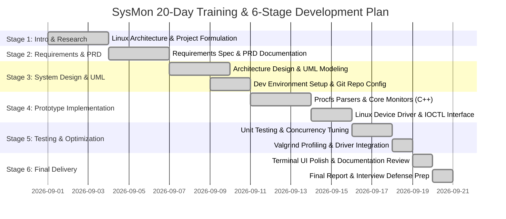

# Stage 2 – Project Requirements Document (PRD) & Development Plan

**Project:** SysMon – System Resource Monitoring Tool & Linux Kernel Driver  
**Version:** 1.0.0  
**Phase:** Stage 2 – Requirements Engineering & Project Planning  

---

## 1. Product Requirements Document (PRD)

### 1.1 Purpose & Target Users
SysMon is designed for Linux system engineers, DevOps specialists, C++ developers, and systems architects who require an accurate, low-overhead resource profiling utility capable of extracting both user-space process statistics and privileged kernel/hardware telemetry.

---

## 2. Functional Requirements (FR)

| Requirement ID | Module | Description | Priority |
| :--- | :--- | :--- | :--- |
| **FR-01** | CPU Engine | Calculate overall CPU utilization % across sample intervals using Linux tick deltas (`user`, `nice`, `system`, `idle`, `iowait`, `irq`, `softirq`, `steal`). | **P0 (Must Have)** |
| **FR-02** | CPU Engine | Calculate and display per-core utilization percentages for Symmetrical Multi-Processing (SMP) hardware (Core 0 to Core N). | **P0 (Must Have)** |
| **FR-03** | CPU Engine | Track and compute instantaneous context switch rate and hardware interrupt rate per second from `/proc/stat`. | **P1 (High)** |
| **FR-04** | Memory Engine | Parse `/proc/meminfo` and report Total, Used, Free, Available, Buffers, Cached RAM, and Dirty writeback pages in human-readable bytes (KB/MB/GB). | **P0 (Must Have)** |
| **FR-05** | Memory Engine | Monitor Swap space utilization (Total, Used, Free, Usage %) and Minor/Major Page Fault rates from `/proc/vmstat`. | **P1 (High)** |
| **FR-06** | Hardware / Arch | Inspect `/sys/devices/system/cpu/cpu0/cache/` to report L1 Data, L1 Instruction, L2, and L3 cache sizes, associativity, and line sizes. | **P1 (High)** |
| **FR-07** | Hardware / Arch | Extract CPU vendor ID, model name, stepping, microarchitecture family, and instruction set flags (SSE, AVX, AVX2, AES) from `/proc/cpuinfo`. | **P1 (High)** |
| **FR-08** | Process Engine | Scan all active numeric PID directories under `/proc/[pid]/`, parsing `stat`, `status`, and `cmdline`. | **P0 (Must Have)** |
| **FR-09** | Process Engine | Extract PID, PPID, username, process state (R, S, D, Z, T), CPU%, Memory RSS/VMS, thread count, priority, and niceness. | **P0 (Must Have)** |
| **FR-10** | Process Engine | Provide multi-criteria process sorting (by CPU%, Memory RSS, PID, Process Name) in ascending or descending order. | **P1 (High)** |
| **FR-11** | Process Engine | Support process signaling via POSIX `kill()` system call to dispatch `SIGTERM` (15) or `SIGKILL` (9). | **P2 (Medium)** |
| **FR-12** | I/O Engine | Monitor block device read/write throughput (KB/s, IOPS) from `/proc/diskstats` and mounted filesystem usage from `statvfs`. | **P1 (High)** |
| **FR-13** | I/O Engine | Monitor network interface transmission and reception rates (RX KB/s, TX KB/s) from `/proc/net/dev`. | **P1 (High)** |
| **FR-14** | Kernel Driver | Implement loadable character device driver registering `/dev/sysmon_driver` providing dynamic major number, RCU task iteration, and `ioctl()` support. | **P0 (Must Have)** |
| **FR-15** | User Interface | Deliver a multi-tab ANSI terminal user interface with non-blocking keyboard input via Linux `termios` raw mode. | **P0 (Must Have)** |

---

## 3. Non-Functional Requirements (NFR)

### 3.1 Performance & Overhead
- **CPU Overhead:** Total CPU utilization of the SysMon monitoring process must not exceed **1.5%** during active 1-second sampling cycles.
- **Memory Footprint:** Resident Set Size (RSS) of SysMon must remain below **15 MB** in user space.
- **Acquisition Latency:** Metric sampling cycle must complete in under **15 milliseconds** per refresh iteration.

### 3.2 Reliability & Fault Tolerance
- **Graceful Fallback:** If `/dev/sysmon_driver` is absent or unprivileged, the application must seamlessly fall back to `/proc` text parsing without crashing or throwing unhandled exceptions.
- **Cross-Environment Compatibility:** The system must run on native Ubuntu Linux, WSL2 (Hyper-V virtualized Linux), and include a synthetic mock mode for non-Linux or test container environments.
- **Terminal State Restoration:** On termination (normal exit or `SIGINT`/`SIGTERM` signals), the application must restore terminal cursor visibility, canonical mode, and echo modes.

### 3.3 Security & Permissions
- User-space monitoring runs under standard unprivileged user accounts (`nobody` / `ubuntu`).
- The kernel driver enforces strict `copy_to_user()` bounds checking to avoid kernel memory corruption or information disclosure.

---

## 4. Deliverables & Project Artifacts

1. **Source Code:**
   - C++17 User-Space Application (`include/`, `src/`, `main.cpp`).
   - Linux Kernel Module C Source (`driver/sysmon_driver.c`, `driver/sysmon_driver.h`, `driver/Makefile`).
2. **Build Configuration:**
   - Root `Makefile` and `CMakeLists.txt` supporting standard compilation, cleaning, and testing targets.
3. **Automated Scripts:**
   - Environment setup script (`scripts/setup_wsl.sh`).
   - Driver loader/unloader (`scripts/load_driver.sh`).
   - Workload stress benchmark (`scripts/run_benchmark.sh`).
4. **Verification & Testing Suite:**
   - C++ Test Harness (`tests/test_runner.cpp`) executing 7 core unit and integration test suites.
5. **Formal Documentation:**
   - 6-Stage complete reports (`docs/STAGE_1_...` through `docs/STAGE_6_...`).
   - Viva & Technical Interview Guide (`docs/INTERVIEW_QUESTIONS_AND_ANSWERS.md`).

---

## 5. Development Plan & Timeline (20-Day Training Alignment)

| Day Range | Stage | Key Milestones & Daily Tasks |
| :--- | :--- | :--- |
| **Days 1–3** | **Stage 1** | Project selection, Linux procfs exploration, problem statement formulation, scope definition. |
| **Days 4–6** | **Stage 2** | Requirements gathering (Functional & Non-Functional), PRD creation, architecture feasibility study. |
| **Days 7–9** | **Stage 3** | High-level system architecture, UML Class diagrams, Sequence diagrams, State Machine diagrams, Git branching strategy. |
| **Days 10–13** | **Stage 4** | Core C++ implementations: `ProcReader`, `CpuMonitor`, `MemoryMonitor`, `ProcessMonitor`, multithreaded collector thread. |
| **Days 14–15** | **Stage 4** | Linux Device Driver: `sysmon_driver.c`, character device registration, IOCTL implementation, `KernelDriverClient`. |
| **Days 16–17** | **Stage 5** | Test runner development, unit test execution, thread safety audits (`std::mutex`), Valgrind leak checking. |
| **Days 18–19** | **Stage 5** | ANSI Terminal UI multi-tab design, non-blocking input integration with `termios`, hot-path optimizations. |
| **Day 20** | **Stage 6** | Final build verification, documentation sign-off, live benchmark demonstration, interview presentation defense. |
