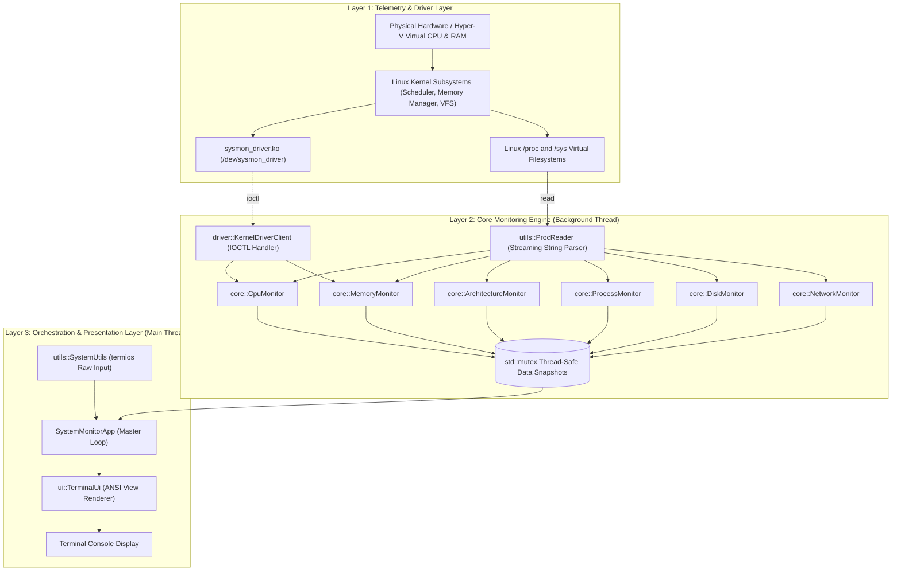
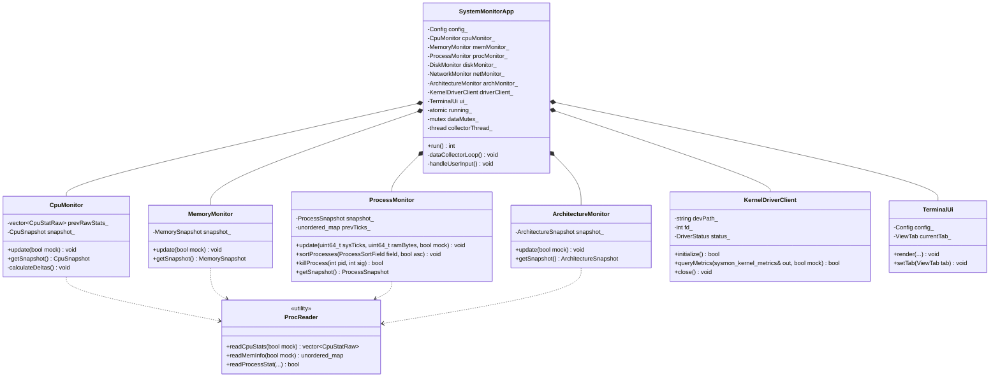
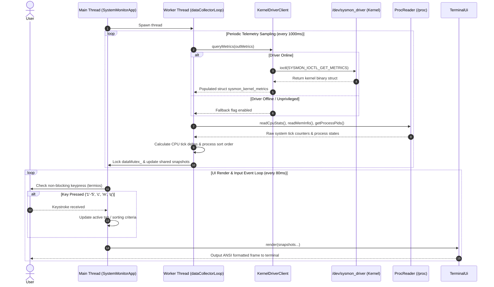
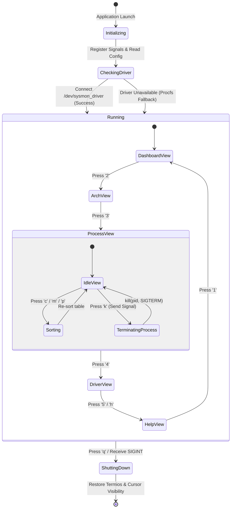

# Stage 3 – System Design & Architecture

**Project:** SysMon – System Resource Monitoring Tool & Linux Kernel Driver  
**Version:** 1.0.0  
**Phase:** Stage 3 – Architectural Design & Technical Specification  

---

## 1. Overall System Architecture

SysMon follows a **layered, decoupled producer-consumer architecture**. The system is divided into three primary layers:
1. **Telemetry & Driver Layer (Kernel Space & Low-Level Interfaces):** Interfaces with Linux virtual pseudo-filesystems (`/proc`, `/sys`) and houses the custom Linux character device driver (`/dev/sysmon_driver`).
2. **Core Monitoring & Processing Layer (User Space Engine):** Encapsulates domain logic for calculating deltas, memory conversions, sorting algorithms, and architecture detection. Operates on a dedicated background collector thread.
3. **Presentation & Interaction Layer (TUI & Controller):** Renders flicker-free ANSI dashboard screens, processes non-blocking keyboard events, and dispatches user actions (sorting, process signaling, tab switching).

### High-Level Architecture Diagram



---

## 2. Major Components and Responsibilities

| Component | Namespace / Class | Key Responsibilities |
| :--- | :--- | :--- |
| **Kernel Driver** | `sysmon_driver.c` | Registers character device `/dev/sysmon_driver`, dynamically obtains major number, traverses `task_struct` using `rcu_read_lock()`, satisfies IOCTL calls with `copy_to_user()`. |
| **Driver Client** | `sysmon::driver::KernelDriverClient` | Manages file descriptor to `/dev/sysmon_driver`, issues IOCTL commands (`SYSMON_IOCTL_GET_METRICS`), maintains driver connection health. |
| **Proc Parser** | `sysmon::utils::ProcReader` | Safely opens and parses `/proc/stat`, `/proc/meminfo`, `/proc/vmstat`, `/proc/diskstats`, `/proc/net/dev`, and PID pseudo-files. Implements mock mode fallback. |
| **CPU Monitor** | `sysmon::core::CpuMonitor` | Computes aggregate and SMP per-core CPU utilization via tick deltas (`delta_work / delta_total * 100`). Tracks context switches and interrupts. |
| **Memory Monitor** | `sysmon::core::MemoryMonitor` | Calculates total, used, free, available, cached RAM, swap space, and page fault frequencies. |
| **Arch Monitor** | `sysmon::core::ArchitectureMonitor` | Interrogates `/sys/devices/system/cpu/` to discover L1d/L1i/L2/L3 cache capacities, associativity, line sizes, and core clock frequencies. |
| **Process Monitor** | `sysmon::core::ProcessMonitor` | Tracks active system processes, PID, PPID, state, thread counts, CPU%, Memory RSS, multi-field sorting, and POSIX signal termination (`kill()`). |
| **Terminal UI** | `sysmon::ui::TerminalUi` | Builds ANSI escape-coded display frames for 5 distinct views (Dashboard, Architecture, Processes, Driver, Help). |
| **App Orchestrator**| `sysmon::SystemMonitorApp` | Coordinates background collection thread (`std::thread`), UI update loop, signal handlers (`SIGINT`, `SIGTERM`), and graceful termination. |

---

## 3. Data Structures Definition

### 3.1 Kernel Shared Structures (`driver/sysmon_driver.h`)
```c
struct sysmon_kernel_metrics {
    uint64_t uptime_seconds;
    uint64_t total_ram_bytes;
    uint64_t free_ram_bytes;
    uint64_t shared_ram_bytes;
    uint64_t buffer_ram_bytes;
    uint64_t total_swap_bytes;
    uint64_t free_swap_bytes;
    uint32_t process_count;
    uint32_t active_cpus;
    uint64_t context_switches;
    uint64_t total_forks;
    uint64_t interrupts_total;
    uint32_t load_avg[3];        /* 1, 5, 15 min load */
    uint64_t sample_timestamp_ns;
};
```

### 3.2 Process Telemetry Structure (`include/core/ProcessMonitor.hpp`)
```cpp
struct ProcessInfo {
    int pid = 0;
    int ppid = 0;
    std::string user;
    std::string name;
    std::string cmdline;
    char state = 'S';
    double cpuPercent = 0.0;
    double memPercent = 0.0;
    uint64_t rssBytes = 0;
    uint64_t vmsBytes = 0;
    long numThreads = 1;
    long priority = 0;
    long nice = 0;
    uint64_t totalTicks = 0;
};
```

### 3.3 Cache Hierarchy Structure (`include/core/ArchitectureMonitor.hpp`)
```cpp
struct CacheLevelInfo {
    int level = 1;
    std::string type;       // "Data", "Instruction", "Unified"
    std::string sizeStr;    // e.g. "32K", "512K", "16M"
    uint64_t sizeBytes = 0;
    int associativity = 0;
    int lineSize = 0;
};
```

---

## 4. UML Diagrams

### 4.1 UML Class Diagram


---

### 4.2 UML Sequence Diagram: Sampling & Telemetry Cycle


---

### 4.3 UML State Machine Diagram: Application Lifecycle


---

## 5. Development Environment & Git Configuration

### 5.1 Toolchain & Dependencies
- **Operating System:** Ubuntu 22.04 LTS (under WSL2) / Native Linux Kernel 5.15+
- **Compiler:** GNU G++ 11.4+ (C++17 Standard Compliant)
- **Build Utilities:** GNU Make 4.3+, CMake 3.22+
- **Kernel Headers:** `linux-headers-$(uname -r)`
- **Debugging & Profiling:** GDB 12.1, Valgrind 3.18, `strace`

### 5.2 Git Repository & Branching Strategy
The project follows **Git Flow** best practices:
- `main`: Production-ready release branch containing tagged milestones (`v1.0.0`).
- `develop`: Primary integration branch where completed stage features are merged.
- `feature/*`: Specific feature branches:
  - `feature/stage1-intro`
  - `feature/stage2-requirements`
  - `feature/stage3-architecture`
  - `feature/stage4-prototype`
  - `feature/stage5-testing`
  - `feature/stage6-final`
  - `feature/kernel-driver`
  - `feature/ansi-ui`

Each commit message follows conventional commits: `feat:`, `fix:`, `docs:`, `test:`, `refactor:`.
